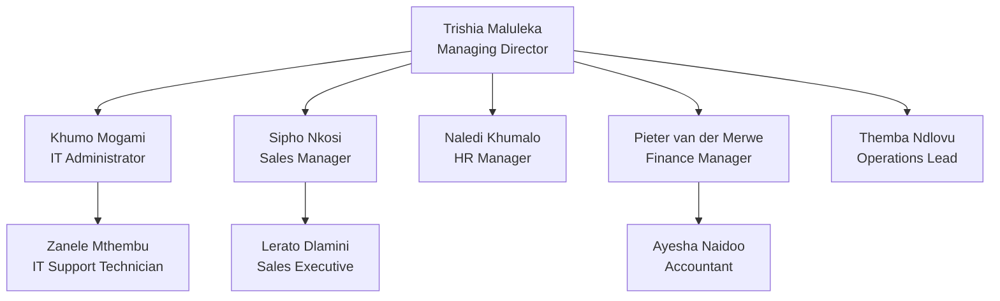

# CloudBridge Technologies

## Company overview
CloudBridge Technologies is a fictional company used
for a Microsoft 365 Enterprise Administration lab.

## Departments
- IT Support
- Human Resources
- Finance
- Operations

## Project objectives
- Manage employee onboarding and offboarding
- Allocate Microsoft 365 licences
- Apply multifactor authentication
- Administer mailbox access
- Manage Microsoft Teams membership
- Configure SharePoint permissions
- Verify that access follows least privilege

## Security principles
- Least-privilege access
- Secure credential handling
- MFA for user accounts
- Documented access changes
- Verification after administrative tasks

